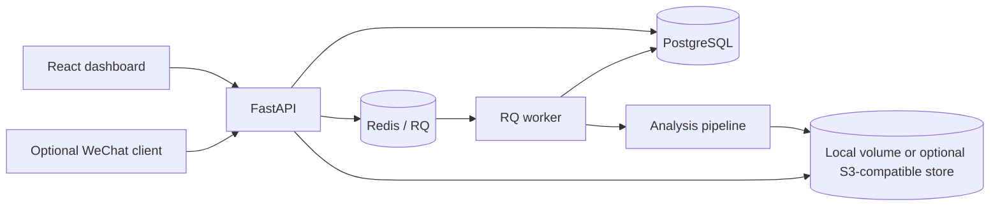

# StepWise

StepWise is a wearable-sensor analytics application for four-channel plantar-pressure and
foot-mounted IMU recordings. It accepts text recordings, runs an explainable signal-processing
pipeline in a background worker, and produces structured results, charts, and a non-diagnostic HTML
report. The project focuses on backend architecture and reproducible data processing rather than
clinical prediction.

> StepWise is an engineering prototype. It is not clinically validated and does not diagnose gait,
> neurological, or musculoskeletal conditions.

## Demo

The repository includes deterministic synthetic recordings, so the application can be demonstrated
without private sensor data.

```text
walking TXT + optional standing calibration
        -> parse and validate
        -> detect foot contact and stance intervals
        -> extract pressure and orientation features
        -> evaluate conservative screening rules
        -> JSON + CSV + PNG charts + HTML report
```

Example outputs are available in [`example_output/`](example_output/). The fixtures are software-test
data only and do not represent clinical gait distributions.

## Architecture



The API validates uploads, stores input artifacts, creates a `QUEUED` database record, and enqueues
the analysis ID. The worker changes the record to `RUNNING`, calls the same pipeline used by the CLI
and tests, stores generated artifacts, and records either `SUCCEEDED` or `FAILED`. The web client
polls the status endpoint while the job runs.

## Tech Stack

| Area | Technology |
|---|---|
| Analysis | Python, pandas, NumPy, Matplotlib |
| API | FastAPI, Pydantic |
| Persistence | SQLAlchemy 2, PostgreSQL, Alembic |
| Background jobs | Redis, RQ |
| Web client | React, TypeScript, Vite |
| Tooling | pytest, Ruff, mypy, ESLint, Docker Compose, GitHub Actions |

## Key Engineering Features

- **Asynchronous jobs:** analysis and report generation run outside the HTTP request, while
  PostgreSQL remains the source of truth for job state.
- **Testable pipeline:** parsing, calibration, contact detection, stance segmentation, feature
  extraction, data-quality checks, and rule evaluation are separate modules.
- **Persistent artifacts:** uploaded recordings and generated reports are referenced in the database
  and stored under path-checked per-analysis directories.
- **Defensive input handling:** the API limits upload size and content type, rejects malformed text,
  sanitizes non-finite JSON values, and returns safe public errors.
- **Reproducible examples:** a fixed-seed generator creates normal, noisy, short, malformed, and
  pressure-loading scenarios for tests and demos.

## Getting Started

### Full application

Docker with Compose is required.

```bash
git clone https://github.com/xiaorui7/StepWise-Wearable-Sensor-Analytics-Platform.git
cd StepWise-Wearable-Sensor-Analytics-Platform
docker compose up --build -d
```

Then open:

- Dashboard: `http://localhost:5173`
- OpenAPI documentation: `http://localhost:8000/docs`
- Health endpoint: `http://localhost:8000/health`

Click **Load demo data** to submit the bundled synthetic walking and standing files.

For two background workers, run `docker compose up -d --scale worker=2`. Retries and recovery
parameters can be set using the variables in `.env.example`.

Useful lifecycle commands:

```bash
docker compose ps          # inspect service health
docker compose logs -f     # follow application logs
docker compose down        # stop the stack without deleting persistent volumes
```

Do not add `-v` to `docker compose down` unless you intentionally want to delete the database and
generated artifacts.

### Optional infrastructure demo

The default stack uses local files. For a private MinIO demo without shared application artifact volumes:

```bash
docker compose -p stepwise-s3 -f docker-compose.yml -f compose.minio.yml --profile s3 up --build -d --scale worker=2
```

Stop the default stack first if its ports are occupied. A separate kind demo runs two API replicas
and two workers with PostgreSQL, Redis and MinIO:

```bash
pip install -e ".[dev,s3]"
python scripts/kind_demo.py up
python scripts/kind_demo.py verify
```

See [setup and storage guarantees](docs/CLOUD_INFRASTRUCTURE.md) and
[executed infrastructure evidence](docs/CLOUD_EVIDENCE.md). This is a single-node local Kubernetes
demo, not a public cloud deployment or a high-availability claim.

### Analysis CLI

The pipeline can also run without PostgreSQL or Redis:

```bash
python -m venv .venv
# Windows: .venv\Scripts\activate
# macOS/Linux: source .venv/bin/activate
pip install -e ".[dev]"

stepwise-analyze fixtures/synthetic/normal_like.synthetic.txt \
  --standing-file fixtures/synthetic/standing_neutral.synthetic.txt \
  --output-dir local-output
```

## API

| Method | Path | Purpose |
|---|---|---|
| `POST` | `/api/v1/analyses` | Upload a walking file and optional calibration file |
| `GET` | `/api/v1/analyses/{id}` | Read persisted job status |
| `GET` | `/api/v1/analyses/{id}/result` | Read a completed structured result |
| `GET` | `/api/v1/analyses` | List recent analyses |
| `GET` | `/api/v1/analyses/{id}/artifacts/{name}` | Retrieve a generated artifact |
| `GET` | `/health` | Process liveness |
| `GET` | `/ready` | Database, Redis and artifact backend readiness |

`POST /api/v1/analyses/text` is retained for the optional WeChat client.

Submission supports an optional `Idempotency-Key`. The same key and input bytes/configuration return
the same analysis ID; reusing the key with different content returns 409. Without a key, each upload
is a new analysis. For example (use `curl.exe` on Windows):

```bash
curl -X POST http://localhost:8000/api/v1/analyses \
  -H 'Idempotency-Key: demo-trial-1' \
  -F 'walking_file=@fixtures/synthetic/normal_like.synthetic.txt' \
  -F 'standing_file=@fixtures/synthetic/standing_neutral.synthetic.txt'
```

Poll the returned ID at `/api/v1/analyses/{id}`, then retrieve `/result` and its artifact URLs.
Interrupted executions can be reconciled with `docker compose exec api stepwise-reconcile`.

## Tests

```bash
pytest --cov=stepwise --cov-branch --cov-report=term
ruff check src tests scripts
mypy src/stepwise

cd web
pnpm install --frozen-lockfile
pnpm lint
pnpm build
```

The suite covers parser failures, sensor mapping, hysteresis contact detection, known stance
intervals, feature direction, screening-rule conflicts, data-quality warnings, JSON sanitation,
artifact path safety, database state, queue failures, and an upload-to-report workflow.

The PostgreSQL-specific test requires `STEPWISE_TEST_POSTGRES_URL`. Other tests use temporary SQLite
databases so they can run without external services.

Run the complete Linux suite, including real PostgreSQL/Redis/RQ worker tests, without installing
database servers on the host:

```bash
docker compose --profile test build tests
docker compose --profile test run --rm tests
```

The October 13 baseline verification passed **72 tests with no skips**: 88.19% statement coverage, 74.61% branch
coverage, and 85.79% combined coverage across `src/stepwise`. Ruff, strict mypy, frontend lint/build,
Docker builds, and PostgreSQL/SQLite migrations also passed. The suite exercises concurrent
idempotency, concurrent claims, two real workers, bounded/scheduled retries, process termination,
artifact publication failures and recovery. Historical Docker startup evidence is in
[`docs/DOCKER_VERIFICATION.md`](docs/DOCKER_VERIFICATION.md); current engineering evidence is in
[`docs/IMPLEMENTATION_REPORT.md`](docs/IMPLEMENTATION_REPORT.md).

The later object-storage extension passed **106 tests with no skips**, including both storage
backends and publication-time interruption. Its separate coverage, kind results and failure
experiments are recorded in [`docs/CLOUD_EVIDENCE.md`](docs/CLOUD_EVIDENCE.md).

## Benchmarks

The direct sequential benchmark includes parsing, analysis, charts and report generation. The load
benchmark additionally exercises HTTP submission, queue waiting, worker execution, persistence and
retrieval. Use the project Python environment installed with `pip install -e ".[dev]"`:

```bash
python scripts/benchmark.py --runs 20 --output-dir benchmarks/core
python scripts/load_benchmark.py --concurrency 1 5 10 20 --jobs 20 --workers 2 --sample-resources
```

For the second command, first start two workers using the command above. `--workers` records the
configured count; it does not start workers. Results and workload definitions are in
[`docs/BENCHMARK.md`](docs/BENCHMARK.md) and [`benchmarks/load-latest.md`](benchmarks/load-latest.md).
These are small synthetic software workloads, not clinical validation or production-load claims.

## Project Structure

```text
src/stepwise/core/       signal processing and screening rules
src/stepwise/api/        FastAPI routes and request/response schemas
src/stepwise/pipeline.py analysis orchestration and artifact generation
src/stepwise/jobs.py     RQ enqueueing and worker execution
src/stepwise/repository.py database state transitions
src/stepwise/storage.py  storage contract and local filesystem implementation
src/stepwise/s3_storage.py optional immutable object storage
src/stepwise/recovery.py interrupted/lost job reconciliation
web/                     React dashboard
miniprogram/             optional WeChat client
tests/                   core, integration, and end-to-end tests
fixtures/synthetic/      deterministic software-test recordings
scripts/                 fixture generation and benchmark tooling
benchmarks/              measured workloads and verification evidence
```

## Design Decisions

- **Modular monolith over microservices:** the workload does not justify independent services, but
  the API and worker run as separate processes from one package.
- **RQ over a streaming platform:** jobs need enqueueing and failure handling, not replay, partitions,
  or multiple event consumers.
- **PostgreSQL owns job state:** Redis transports work; it is not the source of truth for user-visible
  status or results.
- **Synthetic public data:** real recordings are excluded for privacy. Synthetic fixtures verify
  software behavior but cannot establish medical accuracy.

More context is recorded in [`docs/adr/`](docs/adr/) and the engineering thresholds are documented in
[`docs/StepWise_decision_rules_EN.md`](docs/StepWise_decision_rules_EN.md).
The current architecture and consistency limits are described in [`docs/ARCHITECTURE.md`](docs/ARCHITECTURE.md)
and [`docs/RELIABILITY.md`](docs/RELIABILITY.md).

## AWS (optional)

An optional EC2 + private S3 path runs the same Compose application with instance-role credentials.
See [AWS deployment](docs/AWS_DEPLOYMENT.md) for setup, synthetic verification, cost estimates and
teardown. Real AWS execution evidence is pending.

## Future Improvements

- Add a durable enqueue outbox if automatic recovery of DB/Redis submission gaps becomes necessary.
- Define retention and garbage collection for abandoned staging or orphaned output directories.
- Add authentication and per-user data isolation before any multi-user deployment.
- Add retention-aware cleanup for optional object storage; MinIO and kind remain development demos.

## License

This project is available under the [MIT License](LICENSE).
