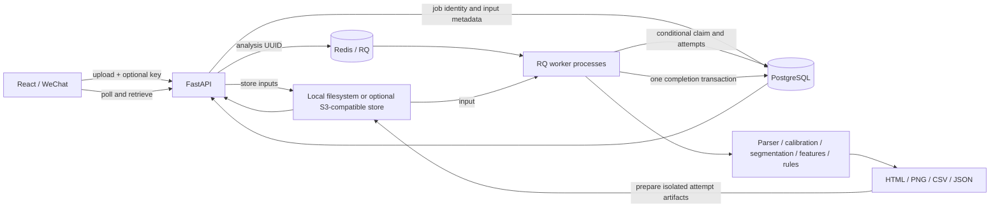

# Architecture

StepWise processes wearable recordings into explainable, non-diagnostic screening reports. The
React dashboard and optional WeChat client share one FastAPI backend and one Python domain package.
There are eight explicit HTTP operations; generated OpenAPI is available at `/docs`.

## Responsibilities

| Component | Responsibility |
|---|---|
| `core/` | Sensor parsing and deterministic calculations; no HTTP or database dependencies |
| `pipeline.py`, `reports/` | In-memory orchestration, rendering and five output artifacts |
| `api/main.py`, `api/schemas.py` | Typed requests, size/format validation, submission, polling, history and artifact retrieval |
| `repository.py`, `db_models.py` | Durable identity, state, attempts, execution ownership and metadata |
| `jobs.py`, `worker.py` | Redis dispatch, bounded retries, process execution and failure classification |
| `storage.py`, `s3_storage.py` | Storage protocol, local atomic rename or private immutable objects with content checks |
| `recovery.py` | Operator-run reconciliation of lost queue jobs and expired executions |

`analyses` stores status, timestamps, attempts, an execution token, lease expiry, optional hashed
idempotency key, request fingerprint, configuration, metadata, result and safe errors. A unique
constraint owns key arbitration across concurrent requests. `artifacts` stores media type, private
storage key and type; `(analysis_id, name)` is unique. An Alembic migration adds the reliability fields
to the original schema without deleting sessions.

## Flow and transactions

1. Validate UTF-8 TXT data, finite numeric rows, size and configuration. Hash canonical effective
   configuration and length-prefixed input bytes. Names and request IDs are not part of the identity.
2. Commit the job identity. A conflicting insert waits for the unique constraint; its caller either
   receives the existing analysis ID or HTTP 409 for changed content.
3. Atomically write the input files, persist their metadata, then enqueue the analysis UUID.
4. The worker conditionally updates `QUEUED` to `RUNNING`, increments attempts and assigns a UUID
   execution token. Only one concurrent update can win. Analysis runs outside a long DB transaction.
5. Build all reports in memory. Locally, rename a staged directory into a token-specific final
   directory. With S3, conditionally write immutable token-specific objects and verify all bytes;
   no multi-object atomicity or directory rename is assumed.
6. Lock and verify the execution token. Insert all artifact metadata and set result plus `SUCCEEDED`
   in one PostgreSQL transaction. Artifact access requires `SUCCEEDED`.

The four public states remain `QUEUED`, `RUNNING`, `SUCCEEDED`, and `FAILED`. During a delayed retry,
PostgreSQL reports `QUEUED` while RQ reports `scheduled`. PostgreSQL remains authoritative after RQ
result retention expires. `attempts` is an additive response field, so existing clients keep polling
the same endpoints. API file validation/persistence runs in a threadpool rather than blocking the
event loop. Analysis remains a background process.

## Deployment

Compose starts `api`, `worker`, `postgres`, `redis`, and `web`; an optional `test` profile adds a Linux
test runner. Increasing worker count uses `--scale worker=2`. Each worker executes one task in its
own RQ child process, isolating Matplotlib rendering and CPU work. The default local stack shares
one filesystem volume between API and workers and runs application containers as a non-root user.
The optional MinIO overlay removes application artifact volumes. The local kind demo runs two API
pods and two RQ worker pods against shared PostgreSQL/Redis/MinIO services, with a one-off migration
Job before application startup. Only dependencies have PVCs. This is one local kind node, not
multi-node high availability. There is no distributed transaction. See
[CLOUD_INFRASTRUCTURE.md](CLOUD_INFRASTRUCTURE.md) for configuration and failure boundaries.

See [RELIABILITY.md](RELIABILITY.md) for failure windows and [BENCHMARK.md](BENCHMARK.md) for measured
small-workload behavior.
